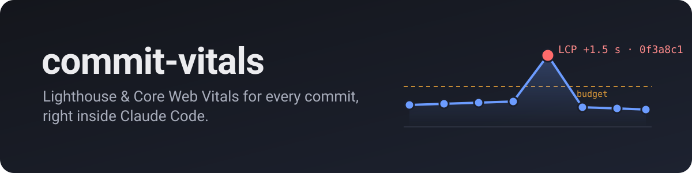
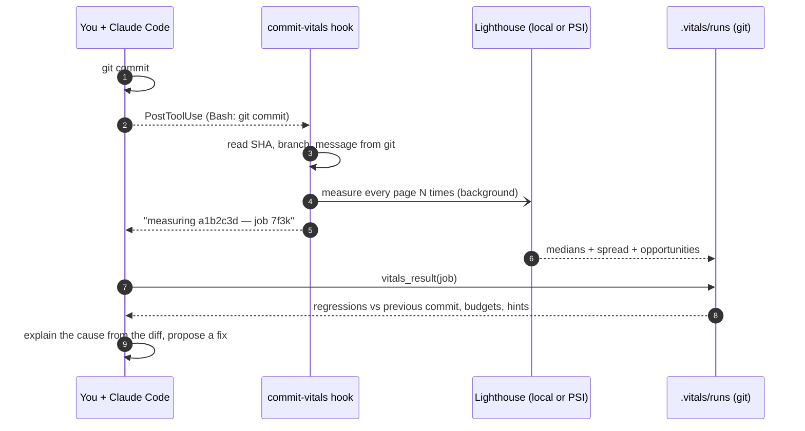
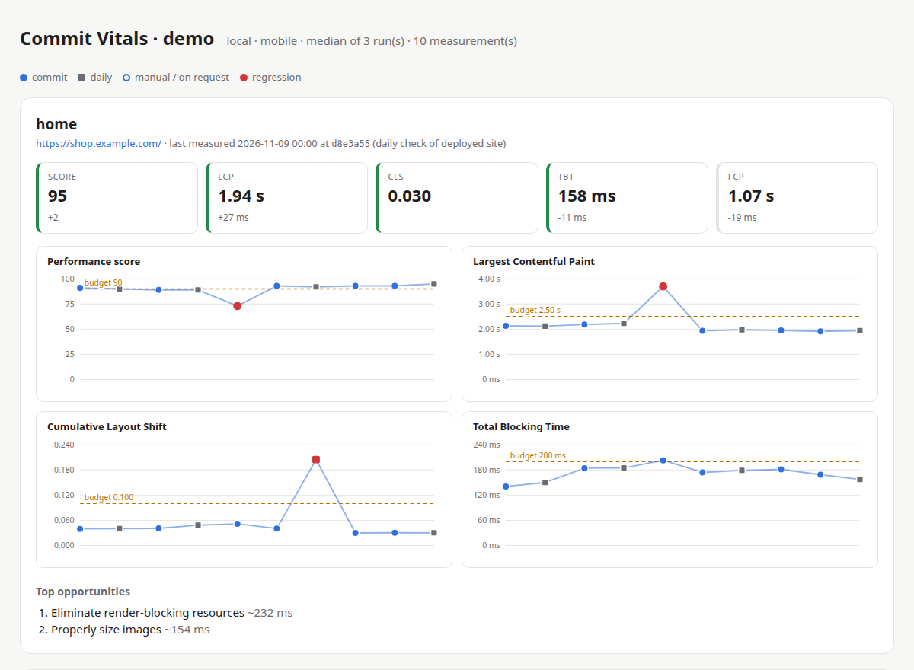

<p align="center">
  
</p>

<p align="center">
  <a href="LICENSE"></a>
  
  
  
  
  <a href="https://github.com/odranoelBR/commit-vitals/actions/workflows/ci.yml"></a>
</p>

**commit-vitals** measures your pages with Lighthouse **after every commit** and **every day**,
keeps the history **in your own repository**, and hands the result to your AI so it can
explain — and fix — the regression it just introduced.

No CI to wire up. No outside access to your repository. No server, no account.
Just a Claude Code plugin.

```
## commit-vitals — `0f3a8c1` feat: full-width hero video

**🔴 2 regression(s) detected**

### home — https://shop.example.com/
Score 72 (-17) 🔴 · LCP 3.65 s (+1450 ms (+66%)) 🔴 · CLS 0.050 · TBT 200 ms (+10 ms (+5%))
Compared with `5be17d4` (commit, 2026-10-30T10:00:00Z).
LCP element: `<video autoplay muted playsinline src="/hero.mp4">`
Top opportunities:
- Eliminate render-blocking resources — ~440 ms
- Properly size images — ~290 ms, 176 KiB
```

> Claude reads this right after committing, opens the diff, sees the new autoplay video, and
> offers to add a poster image with `fetchpriority="high"` and lazy-load the video. The next
> commit is measured automatically and confirms the fix.

---

## Contents

- [Why](#why)
- [How it works](#how-it-works)
- [Install](#install)
- [Quick start](#quick-start)
- [Measuring *the code of a commit*](#measuring-the-code-of-a-commit)
- [Daily checks](#daily-checks)
- [The report](#the-report)
- [How a regression is decided](#how-a-regression-is-decided)
- [Configuration](#configuration)
- [Reference: skills, MCP tools, CLI](#reference)
- [Where the data lives](#where-the-data-lives)
- [Lab data vs. real users](#lab-data-vs-real-users)
- [Troubleshooting](#troubleshooting)
- [Roadmap](#roadmap)
- [Contributing](#contributing)

## Why

Performance rarely breaks in one dramatic change. It erodes one commit at a time: a bigger hero
image, a new SDK, a font swap, a banner without reserved space. By the time someone runs
Lighthouse by hand, nobody remembers which change did it.

The usual answer is Lighthouse CI: pipelines, tokens, a results server, and yet another
service with access to your code. **commit-vitals** takes a different route:

| | Lighthouse CI | commit-vitals |
|---|---|---|
| Setup | pipeline config + server/storage | `/commit-vitals:setup` |
| Third-party access to your repository | yes | **none** — runs where your code already is |
| Who reads the result | a person, later, in a dashboard | **your AI, seconds after the commit** |
| Attribution to a commit | CI environment | read from local `git` — never guessed |
| History | external server | JSON files **in your repo**, shared through git |
| Catches non-code regressions (CMS, tag manager) | no | **yes**, with daily checks |

## How it works



The plugin bundles four pieces:

- **A hook** that notices `git commit` in Claude's shell calls and starts a background
  measurement (deduplicated by commit SHA, so a failed commit does nothing).
- **An MCP server** (zero dependencies) that Claude uses to measure, read results, compare
  commits and render the report.
- **Skills** for setup, scheduling, on-demand measuring, and triaging regressions.
- **A CLI** that does the same from your terminal, cron, or a plain git hook.

## Install

In Claude Code:

```
/plugin marketplace add odranoelBR/commit-vitals
/plugin install commit-vitals@commit-vitals
```

Requirements:

- **Node.js 18.20+** (Lighthouse 13 is used automatically on Node ≥ 22.19, Lighthouse 12 otherwise)
- **Google Chrome or Chromium** for the `local` engine (set `CHROME_PATH` to choose one)
- Nothing else — Lighthouse is fetched by `npx` on first use and cached

## Quick start

```
/commit-vitals:setup http://localhost:4173/ http://localhost:4173/products/1
```

Claude asks a few questions (engine, budgets, how commits should be measured), writes
`.vitals/config.json`, and takes a **baseline** measurement. From then on:

- every commit Claude makes is measured in the background, and Claude checks the result;
- `/commit-vitals:measure` re-tests on demand;
- `/commit-vitals:schedule` sets up daily checks;
- `/commit-vitals:report` renders the timeline.

Commit the `.vitals/` folder so your team shares the history.

Prefer the terminal?

```bash
npx -y github:odranoelBR/commit-vitals init --url home=https://example.com/ --url pricing=https://example.com/pricing
npx -y github:odranoelBR/commit-vitals measure
```

## Measuring *the code of a commit*

Right after `git commit`, a deployed URL still serves the **previous** version. Pick the
strategy that matches your workflow:

| Strategy | When | How |
|---|---|---|
| **Local production build** | most projects | `engine: "local"` with the URLs of `npm run build && npm run preview` (never the dev server — it is 3–10× slower and meaningless) |
| **Wait for the deploy** | preview deploys (Vercel, Netlify…) or staging | expose the SHA in the page and set `onCommit.waitFor`: commit-vitals polls until the page reports the new commit, then measures |
| **Daily only** | production you don't deploy per commit | `onCommit.enabled: false` + a daily schedule |

Exposing the SHA is one line in your layout:

```html
<meta name="commit-sha" content="{{ GIT_COMMIT_SHA }}">
```

```json
"onCommit": { "enabled": true, "waitFor": { "type": "meta", "name": "commit-sha", "timeoutSec": 600 } }
```

`"type": "header"` with e.g. `"name": "x-commit-sha"` works too. If the deploy never shows
up, the page is recorded as *not measured* rather than attributing old code to the new commit.

## Daily checks

Production changes without commits: a new tag in Google Tag Manager, a 2 MB banner uploaded
by marketing, a third-party script that got slower. Daily runs catch those.
`/commit-vitals:schedule` offers three ways:

| Option | Runs when | Best for |
|---|---|---|
| **Claude desktop scheduled task** | daily while the app is open (a missed run happens at next launch) | an *explained* report every morning |
| **System cron** | always, zero tokens | silent data collection |
| **Cloud routine** (`/schedule`) | always, even with your machine off | public URLs with the `psi` engine |

Daily points appear as squares on the timeline, commits as dots.

## The report

`/commit-vitals:report` (or `commit-vitals report`) writes a self-contained
`.vitals/report.html` — no external assets, share it anywhere.

<p align="center">
  
</p>

Above: a hero video regresses LCP at `0f3a8c1` and the next commit fixes it; later a
**daily** check catches a CLS spike from a promo banner that no commit introduced.

## How a regression is decided

Lighthouse is noisy, and a tool that cries wolf gets ignored. commit-vitals is conservative:

1. **Median of N runs** per page (default 3), with the min/max spread stored.
2. A metric must get worse by more than **both** an absolute and a relative threshold
   (e.g. LCP +150 ms **and** +10%).
3. With 2+ runs, the **ranges must not overlap**: every run of the new commit must be worse
   than every run of the baseline. Otherwise the change is reported as *within noise*.
4. The baseline is the latest earlier run of that page with the **same engine and form
   factor** — mobile is never compared with desktop.

Rule 3 came from measuring a real store: two identical commits moved CLS from 0.36 to 0.46
because of a rotating banner. Thresholds alone called that a regression; the overlap rule
correctly calls it noise.

Budgets are separate: a page over budget is reported as *debt*, not as a regression.

## Configuration

`.vitals/config.json` — only `urls` is required; everything else has defaults.

```jsonc
{
  "engine": "local",            // "local" (this machine) | "psi" (PageSpeed Insights API)
  "formFactor": "mobile",       // "mobile" | "desktop"
  "runs": 3,                    // Lighthouse runs per page; the median is stored (1–9)
  "urls": [
    { "name": "home", "url": "http://localhost:4173/" },
    { "name": "product", "url": "http://localhost:4173/p/1", "budgets": { "lcp": 3000 } }
  ],
  "budgets": { "score": 90, "lcp": 2500, "cls": 0.1, "tbt": 200 },
  "regression": { "score": 5, "lcpMs": 150, "lcpPct": 10, "cls": 0.02, "tbtMs": 75, "tbtPct": 20 },
  "onCommit": { "enabled": true, "waitFor": null },
  "lighthouse": { "version": null, "chromeFlags": ["--headless=new", "--no-sandbox"] },
  "psi": { "apiKeyEnv": "PSI_API_KEY" }
}
```

| Engine | Reaches | Extra | Needs |
|---|---|---|---|
| `local` | anything this machine can open: localhost, VPN, previews | full control, same machine every time | Chrome |
| `psi` | public URLs only | **real-user CrUX data** (p75 LCP, INP, CLS) next to lab data | optional `PSI_API_KEY` for a higher quota |

## Reference

### Skills (slash commands)

| Command | What it does |
|---|---|
| `/commit-vitals:setup [urls]` | configure pages, engine, budgets and commit strategy; take a baseline |
| `/commit-vitals:measure [pages]` | measure now and report against the previous run |
| `/commit-vitals:schedule [time]` | daily checks via desktop task, cron or cloud routine |
| `/commit-vitals:report` | render the HTML timeline |
| `regression-triage` *(automatic)* | when a regression shows up: metric → likely cause in the diff → fix → verify |

### MCP tools

| Tool | Purpose |
|---|---|
| `vitals_status` | config, running job, latest result |
| `vitals_init` | create/update `.vitals/config.json` |
| `vitals_measure` | start a background measurement (optionally wait for it) |
| `vitals_result` | result of a job or the latest run, with regressions and hints |
| `vitals_history` | table of recent runs |
| `vitals_compare` | compare any two commits |
| `vitals_report` | write the HTML report |
| `vitals_setup_info` | paths and ready-made cron / git-hook commands |

### CLI

```text
commit-vitals init --url name=https://… [--engine local|psi] [--form-factor mobile|desktop] [--runs n]
commit-vitals measure [--trigger manual|commit|daily] [--only a,b] [--background] [--json]
commit-vitals status | history [--limit n] [--page name] | compare [shaA shaB] | report [--out file]
commit-vitals install-git-hook    # also measure commits made outside Claude Code
```

## Where the data lives

```text
.vitals/
├── config.json                         # commit this
├── runs/                               # commit this — the history
│   └── 2026-11-12T16-06-43-046Z_54d3baf_commit.json
└── jobs/  logs/  report.html           # local only (gitignored automatically)
```

One file per measurement means teammates never hit merge conflicts. Each file records the
commit (SHA, branch, message, dirty flag), medians and spread per page, the LCP element, the
top opportunities, real-user data when available, and the environment (Lighthouse version,
Node, CPU), so you can tell when the yardstick itself changed.

## Lab data vs. real users

Lighthouse produces **lab** data: a simulated mid-range phone on a throttled network. That is
ideal for comparing commits, because the conditions are fixed. It is not what your users
experience, and it cannot measure **INP** (it reports TBT as the closest proxy).

With the `psi` engine, each result also carries Google's **CrUX** field data (75th percentile
of real Chrome users over 28 days) when the page has enough traffic. Use lab data to catch
regressions early; use field data to know whether users are fine.

## Troubleshooting

| Symptom | Fix |
|---|---|
| `Lighthouse exited … Chrome not found` | install Chrome/Chromium or set `CHROME_PATH` |
| the first measurement is slow | `npx` downloads Lighthouse once; later runs use the cache |
| `engine "psi" cannot reach private host` | use `engine: "local"` for localhost/VPN URLs |
| PSI `429` errors | create a free API key and export `PSI_API_KEY` |
| `deploy not confirmed` | the page never showed the new SHA — check the meta tag/header or raise `timeoutSec` |
| numbers jump between runs | raise `runs` to 5; close heavy apps; on laptops, stay plugged in |

## Roadmap

- [ ] Authenticated flows (cart, checkout) via Lighthouse user flows
- [ ] CrUX API for the `local` engine (field data without PSI)
- [ ] Desktop + mobile in the same run
- [ ] Optional team dashboard that receives runs pushed by the plugin
- [ ] Publish to npm for faster `npx` starts

## Contributing

Issues and pull requests are welcome. The project uses **git-flow**: branch from `develop`
as `feature/<name>` and open the PR against `develop`; releases are cut to `main`.
See [CONTRIBUTING.md](CONTRIBUTING.md).

```bash
npm test                                   # node:test, no dependencies
node scripts/demo-report.mjs /tmp/demo     # regenerate the demo report
```

## License

[MIT](LICENSE) © Leonardo Muniz
